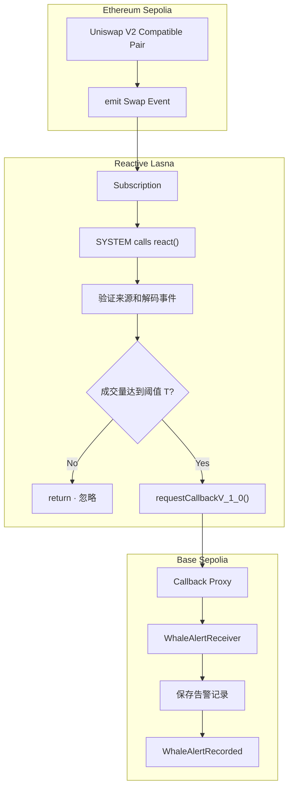

# D1 · Whale Swap Monitor 用例拆解

## ANALYSIS · 业务定位

**Whale Swap Monitor：基于 Reactive 的 DEX 大额交易监控与跨链告警系统。**

监听 Ethereum Sepolia 上指定 Uniswap V2 兼容 Pair 的 Swap 事件，当指定 Token 的单笔成交量达到预设阈值时，由 Reactive Lasna 执行确定性判断，并通过 Callback 在 Base Sepolia 记录一条可追溯的大额交易告警。

本方案重点解决：如何及时发现 DEX 流动性池中的大额交易，并将风险信号传递到其他链。

## 1. 监听哪条链、哪个合约的什么事件？

### Source Chain

- 网络：Ethereum Sepolia
- Chain ID：11155111
- 合约：指定 Uniswap V2 兼容 Pair
- 事件：`Swap(address,uint256,uint256,uint256,uint256,address)`

事件签名：

```solidity
event Swap(
    address indexed sender,
    uint amount0In,
    uint amount1In,
    uint amount0Out,
    uint amount1Out,
    address indexed to
);
```

Topic 0：

`0xd78ad95fa46c994b6551d0da85fc275fe613ce37657fb8d5e3d130840159d822`

事件字段：

| 字段 | 含义 |
|---|---|
| sender | 发起 Pair Swap 的调用者 |
| amount0In | Token0 流入数量 |
| amount1In | Token1 流入数量 |
| amount0Out | Token0 流出数量 |
| amount1Out | Token1 流出数量 |
| to | 输出 Token 的接收地址 |

订阅条件：

- Source Chain ID 精确匹配 11155111。
- Source Contract 精确匹配指定 Pair 地址。
- Topic 0 精确匹配 Swap。
- Topic 1–3 使用 REACTIVE_IGNORE。

Pair 地址将在选定真实测试样本并核验合约代码后锁定，不使用未经验证的地址。

## 2. 满足什么条件时触发？

### Subscription 过滤

Reactive SYSTEM 只接收指定 Sepolia Pair 的 Swap 日志。

### react() 确定性判断

1. 检查来源 Chain ID。
2. 检查 Pair 合约地址。
3. 检查 Topic 0、opCode 和数据长度。
4. 解码 Token0、Token1 的成交数量。
5. 根据已确认的 Token decimals 进行单位转换。
6. 使用来源交易哈希和日志索引进行去重。
7. 判断被监控 Token 的单笔成交量是否达到阈值 T。

触发条件：

`MonitoredTokenAmount >= T`

T 为可配置业务阈值，实际数值需要根据真实 Pair 的 Token 单位和成交样本确定。

不满足条件时使用 return 结束处理，不使用 revert 过滤普通事件。

注意：成交量大不等于价格冲击大。若要进一步识别价格冲击，需要提供可靠的成交前储备或参考价格基准，作为后续 Whale Impact Risk Guard 的扩展。

## 3. 在哪条链做什么动作？

### Destination Chain

- 网络：Base Sepolia
- Chain ID：84532
- 目标合约：WhaleAlertReceiver（待实现）

当 Lasna Reactive 判断事件满足阈值后：

1. 调用 SYSTEM.requestCallbackV_1_0()。
2. Reactive Network 通过 Base Sepolia Callback Proxy 投递。
3. WhaleAlertReceiver 验证服务提供方和授权 Reactive 身份。
4. 记录源链交易、Pair 地址、成交方向、Token 数量及触发原因。
5. 发出 WhaleAlertRecorded 事件。

目标链只负责记录和分发告警，不直接执行买卖交易。

## 4. 如果不用 Reactive，如何实现？

传统方式需要自己部署一个持续运行的 Bot：

1. 通过 RPC / WebSocket 监听指定 Pair 的 Swap。
2. Bot Server 解析事件日志。
3. 检查 Pair、Token、成交数量及重复事件。
4. 满足条件后由 Bot Wallet 签名。
5. 通过 RPC 向 Base Sepolia 发送交易。
6. 目标链 Receiver 记录告警。

需要自己维护：

- RPC / WebSocket 连接及断线重连。
- 区块补读、重复事件和重组处理。
- Swap 日志解析和业务判断。
- Wallet、Signer、Nonce 管理。
- 交易广播、重试及状态确认。
- 服务器运行、监控和私钥安全。

Reactive 的优势：

- 通过 Subscription 注册链上事件过滤条件。
- 无需自己维护专用的持续监听服务器。
- 使用 Solidity 在 Reactive 链上执行确定性业务判断。
- 通过 Callback 机制完成跨链告警投递。

Reactive 的代价：

- 每次匹配事件执行 react() 都可能产生费用。
- 未达到业务阈值的事件也可能消耗 Reactive 执行费用。
- Callback 需要独立的目标链执行储备。
- 必须管理 Balance、Reserves 和 Debt。
- 依赖 Reactive Network 的事件摄取及执行服务。

因此，Subscription 应尽可能精确地限制来源链、合约和事件类型，将金额等无法直接通过 Topic 表达的业务条件放到 react() 中判断。

## 5. 源链 → Reactive → 目标链流程图



## VERIFIED · 与现有实验的关系

D3 已经验证指定 ERC-20 Transfer 事件可以触发 Lasna react()。

D4 已经验证 Sepolia → Lasna → Base Sepolia 的真实 Callback 投递，以及目标合约的双重权限检查。

上述实验为本用例提供了事件触发、执行资金管理和跨链 Callback 的技术基础，但尚未验证真实 Pair 的 Swap 解码、大额成交识别及 WhaleAlertReceiver 的完整业务实现。

## TODO · 后续验证

1. 选定一个真实 Uniswap V2 兼容 Pair。
2. 获取真实 Swap 日志并与 Pair ABI 解码结果核对。
3. 确定 Token decimals 和大额成交阈值。
4. 验证满足阈值和不满足阈值的两类事件。
5. 实现 WhaleAlertReceiver 并验证 Callback。
6. 记录匹配事件成本、有效告警比例及单次告警成本。

## 参考资料

- [Uniswap V2 Pair 源码](https://github.com/Uniswap/v2-core/blob/master/contracts/UniswapV2Pair.sol)
- [Reactive Contracts](https://dev.reactive.network/reactive-contracts)
- [Callback Contracts](https://dev.reactive.network/callback-contracts)
- [Reactive 与 Bot](architecture/reactive-vs-bot.md)
- [Uniswap V2 Swap 解码](scenarios/uniswap-v2-swap-decoding.md)
- [D3 Transfer Monitor](D3-transfer-monitor.md)
- [D4 Cross-chain Callback](D4-deployment-record.md)
