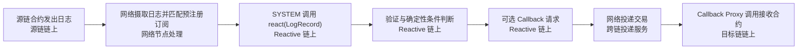

# 架构笔记 · 事件驱动执行

## ANALYSIS · 执行顺序

订阅配置由 Reactive 合约先在 Reactive 链上注册。触发后，`react()` 应核验来源、区分重复日志、检查条件并限制响应次数。若要在目标链行动，Reactive 合约通过 SYSTEM 提出 Callback 请求，网络投递独立交易，目标链由 Callback Proxy 调用授权的接收方法。目标链结果须另行核对回执、事件和状态，费用见 [D2](../D2-network-and-economy.md)。

## VERIFIED · D3 的实测边界

[Transfer Monitor](../D3-transfer-monitor.md) 已核验从源链日志到 SYSTEM 调用和 Reactive 状态变化。Callback 部分为架构说明，D3 未部署接收合约。

[Reactive Contracts](https://dev.reactive.network/reactive-contracts) · [Callback Contracts](https://dev.reactive.network/callback-contracts) · [Reactive 与 Bot](reactive-vs-bot.md)
